# CSE461 Project – FocusPal: Smart Study Companion Robot

**FocusPal** is an Arduino Uno desk robot that helps students and remote workers study better. It runs Pomodoro focus/break sessions and **locks your phone in a servo-driven compartment during focus time**. It also warns you when you sit too close, monitors temperature, humidity, light and noise, and pauses when you leave the desk. Feedback comes through an LCD, an animated OLED robot face, moving servo "ears" and voice clips.

**Course:** CSE461 – Introduction to Robotics, BRAC University (Summer 2026)
**Team (Group 06, Section 09):** Omar Faruk, Md. Jubaid Hasan, Zobeida Zaman Chowdhury, Hasan Mohammad Sayem, Navil Hossain Chowdhury

<p align="center">
  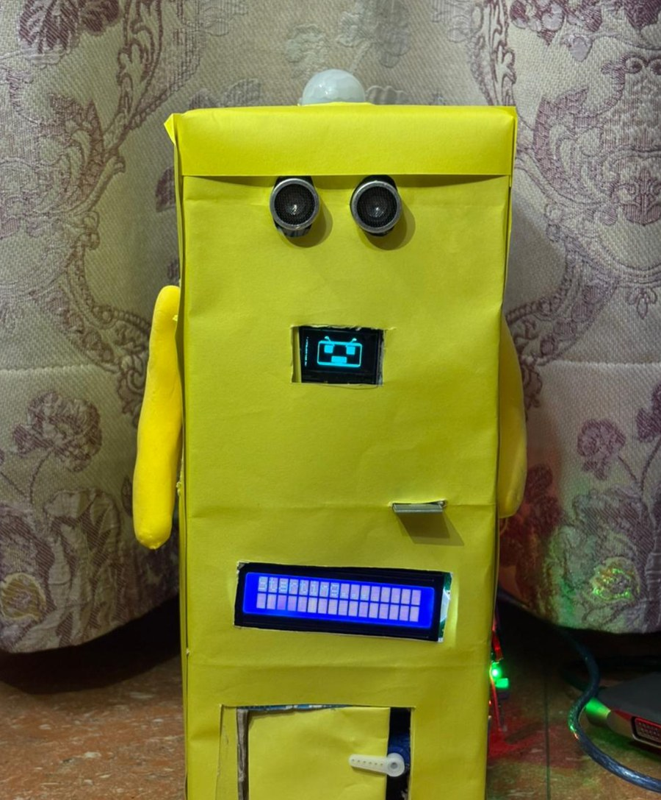
  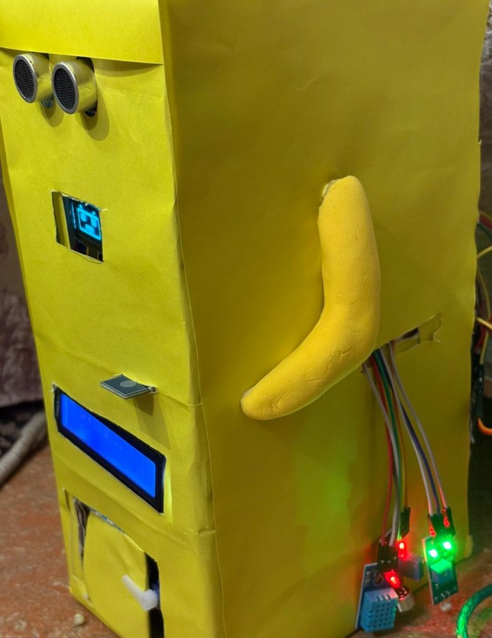
  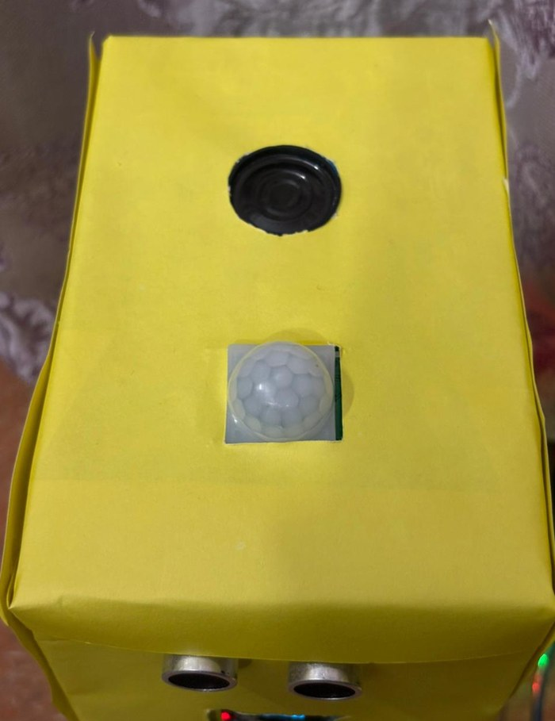
</p>
<p align="center"><sub>Front: ultrasonic "eyes", OLED face, LCD and phone compartment · Side: servo ear and wiring · Top: speaker and PIR sensor</sub></p>

## Features

| Feature | How it works |
|---|---|
| **Pomodoro timer** | Modes **M1** 25 min focus / 5 min break, **M2** 50 / 10, **M3** 1 / 1 (a short demo mode). It switches between focus and break automatically, counts sessions, and resets the count at midnight using the RTC. |
| **Phone lock compartment** | A servo locks the compartment door (120°) when a focus phase starts and unlocks it (0°) for the break. Stopping a session early or pressing reset also unlocks it. |
| **Servo ears** | Two mirrored SG90s show the robot's state: home 90°, focus 70° (upright), break 20° (droopy). They shake between 40° and 100° when you sit too close. |
| **Animated OLED face** | A 128×64 SH1106 screen shows a blinking robot face. When the system sleeps, it switches to a sleepy face with "Zzz". |
| **Posture warning** | The HC-SR04 checks distance every 300 ms. Closer than 30 cm shows **"Too Close!"** with the distance, shakes the ears and plays a voice warning. |
| **Noise monitor** | The microphone is sampled every 100 ms. Above the threshold, it shows **"Too Much Noise!"** with the reading. |
| **Climate monitor** | DHT11 temperature and humidity on the home screen, next to the RTC clock. With 4 taps, humidity is classed as *Too Dry* (< 30%), *Normal* or *Too Humid* (> 70%). |
| **Smart desk light** | *Auto:* LED brightness follows the LDR reading. *Manual:* three brightness levels. |
| **Away detection** | With no PIR motion for 30 s outside a session, it shows **"Are you away?"** and pauses. When you return, it resumes with **"Welcome Back"**. |
| **Hydration reminder** | **"Drink Water"** on the LCD plus a voice reminder. The interval is set to 1 minute for the demo and can be changed with `hydrationInterval`. |
| **Sleep mode** | After 10 s paused, it shows "Going to sleep" and the OLED switches to the sleepy face. |
| **Reset button** | Restarts the system. Because the compartment starts unlocked, this also works as an emergency phone unlock. |

### Touch gestures (TTP223)

| Gesture | Action |
|---|---|
| Single tap | Start / stop a Pomodoro session, or pause / resume in normal mode |
| Double tap | Switch the light between auto and manual |
| Triple tap | Cycle manual brightness (off → low → high) |
| 4 taps | Show humidity and its classification |
| Long press (> 1.2 s, while paused) | Cycle mode: Normal → M1 → M2 → M3 |

## System design

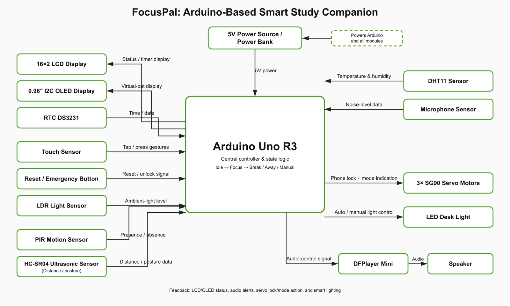

<details>
<summary>System flowchart</summary>

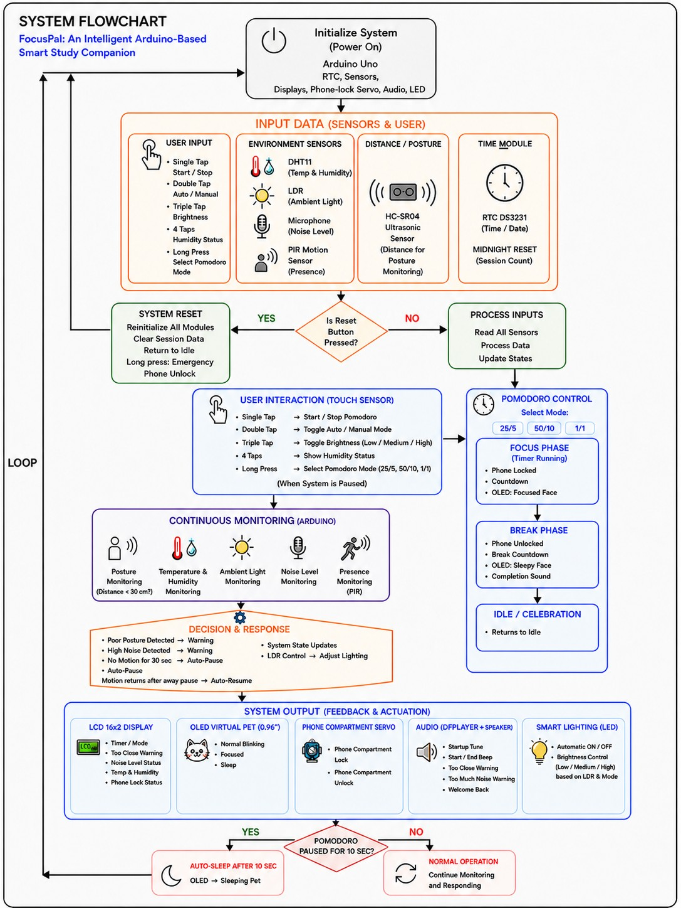

</details>

### Circuit

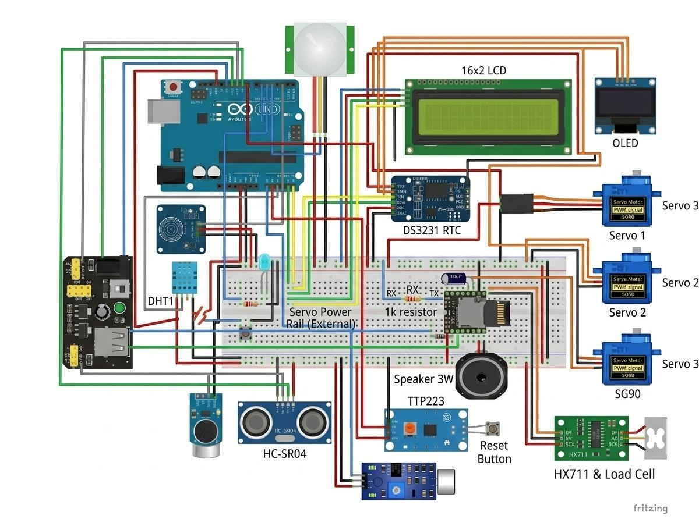

<sub>The early schematic includes an HX711 load cell for a smart water-bottle scale. The final build left it out and uses a timed hydration reminder instead.</sub>

### Pin mapping

| Arduino pin | Connected to |
|---|---|
| D2 | TTP223 touch sensor |
| D3 | DHT11 data |
| D4 | PIR sensor output |
| D5 (PWM) | Desk-light LED |
| D6 | Reset / emergency button (`INPUT_PULLUP`) |
| D7, D8 | Left and right ear servos (mirrored) |
| D9 / D10 | HC-SR04 TRIG / ECHO |
| D11 / D12 | DFPlayer Mini, SoftwareSerial (Arduino RX / TX) |
| D13 | Phone-lock servo |
| A0 | Microphone (analog) |
| A1 | LDR (analog) |
| A4 / A5 (SDA / SCL) | Shared I2C bus: 16x2 LCD (`0x27`), SH1106 OLED (`0x3C`), DS3231 RTC |

The servos run from a separate power rail (a breadboard power module), so they don't cause the Arduino to brown out.

### Implementation notes

- **Memory-efficient OLED driver.** The Uno has only 2 KB of RAM, which is too little for a full 1 KB frame buffer next to everything else. So the sketch talks to the SH1106 directly over I2C. It keeps just **one 128-byte page** in memory, draws each of the 8 pages in turn, and sends them in 16-byte chunks to fit the Wire library's buffer. The face shapes (rounded head, antennae, eyes, mouth) are drawn from simple line and rectangle helpers.
- **Non-blocking design.** Each subsystem has its own `millis()` timer: OLED frames every 250 ms, distance every 300 ms, noise every 100 ms, DHT11 every 2 s. This lets seven sensors and five outputs share one loop.
- **Simple state model.** The system moves between Idle, Focus and Break, with Away and Sleep states while paused. Short messages such as noise, humidity and hydration take over the LCD for 3 s and then return to the main screen.
- **Resource use:** about 22 KB of flash (68%) and 1.36 KB of RAM (67%) on the ATmega328P.

## Hardware

| Component | Qty | Purpose |
|---|---|---|
| Arduino Uno R3 | 1 | Main controller |
| HC-SR04 ultrasonic sensor | 1 | Sitting distance (the robot's "eyes") |
| HC-SR501 PIR sensor | 1 | User presence |
| DHT11 | 1 | Temperature and humidity |
| LDR light sensor module | 1 | Ambient light |
| High-sensitivity microphone module | 1 | Noise level |
| TTP223 capacitive touch sensor | 1 | Gesture input |
| Push button | 1 | Reset / emergency unlock |
| 16x2 LCD with I2C backpack | 1 | Status text and timers |
| 0.96" I2C OLED (SH1106, 128×64) | 1 | Animated robot face |
| DS3231 RTC module | 1 | Clock and daily session reset |
| SG90 servo motor | 3 | Two ears and the phone lock |
| DFPlayer Mini + 28 mm speaker | 1 | Voice clips |
| LED + resistors, capacitor, breadboard power module | – | Desk light and power |

**Total cost: BDT 4,345.** The enclosure is recyclable cardboard. The full breakdown is in the [report](Project_Report.pdf).

## Results

| | |
|---|---|
| 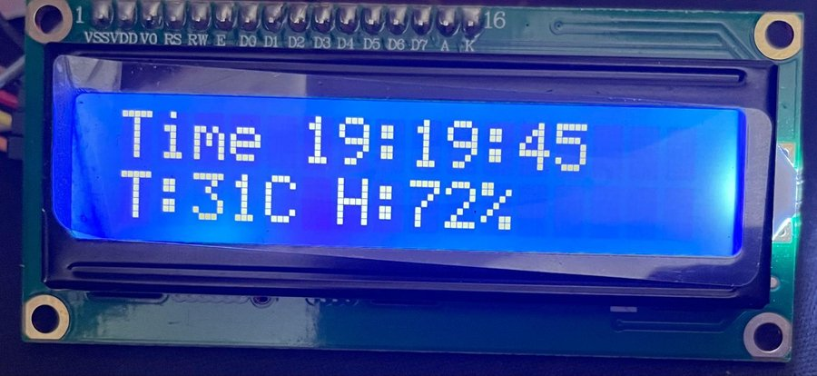<br><sub>Home screen: time, temperature, humidity</sub> | 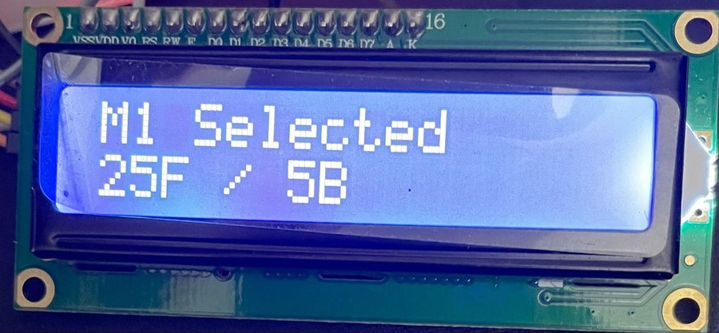<br><sub>Long press: Pomodoro mode M1 selected</sub> |
| 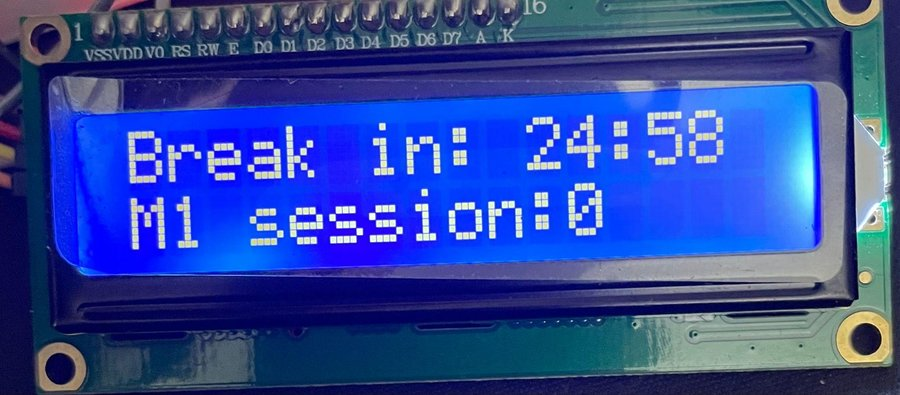<br><sub>Focus session running (phone compartment locked)</sub> | 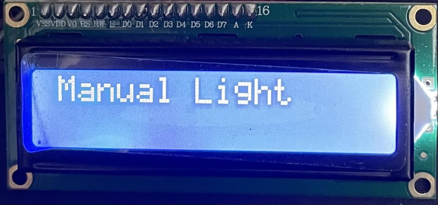<br><sub>Double tap: manual light control</sub> |

| Subsystem | Test | Observed behaviour |
|---|---|---|
| Posture | User seated closer than 30 cm | LCD warning, ear shake and voice alert within about 1 s |
| Pomodoro | 25-min focus mode started | Phone compartment locked at once, countdown shown on the LCD |
| Environment | Humidity above 70% near the DHT11 | "Too Humid" shown after the four-tap gesture |
| Presence | No motion for 30 s | System auto-paused, then the OLED switched to the sleepy face |

The main thing still to improve is gesture timing. Double and triple taps sometimes had to be repeated, so the tap window needs more tuning.

## How to run

1. Install the **Arduino IDE** (2.x).
2. Install these libraries from *Library Manager*:
   - **LiquidCrystal I2C** by Frank de Brabander (provides `lcd.begin(16, 2)`)
   - **SimpleDHT**
   - **RTClib** (Adafruit, which also installs Adafruit BusIO)
   - **DFRobotDFPlayerMini**
   - `Servo`, `Wire` and `SoftwareSerial` come with the IDE.
   - The OLED needs no library, because the sketch has its own driver.
3. Copy the files from [`voice/`](voice) onto a FAT32 microSD card, into a folder named **`mp3`**, and insert it into the DFPlayer:

   | File | Clip |
   |---|---|
   | `0001.mp3` | Beep (session start / phase change) |
   | `0002.mp3` | "Too close" warning |
   | `0003.mp3` | Startup tune |
   | `0004.mp3` | Welcome back / resuming |
   | `0005.mp3` | Drink water reminder |

4. Wire the parts using the pin table, and power the servos from a separate 5 V rail.
5. Open `desk_companion/desk_companion.ino`, select **Arduino Uno**, and upload.

Timings and thresholds are constants near the top of the sketch: `focusDurations`, `breakDurations`, `hydrationInterval`, `noiseThreshold`, and the servo angles.

## Contributions

| Member | Role | Work |
|---|---|---|
| **Omar Faruk** | System integration and Pomodoro control | Wrote the core Arduino program: Pomodoro modes, session counting, focus/break state changes and phone-compartment lock control. |
| Md. Jubaid Hasan | Posture monitoring | HC-SR04 integration, the 30 cm threshold, and the LCD and audio posture alerts. |
| Zobeida Zaman Chowdhury | Environment and lighting | DHT11 monitoring, microphone noise detection, LDR auto/manual lighting and humidity feedback. |
| Hasan Mohammad Sayem | User interface and feedback | Touch gestures, LCD screens, OLED face and DFPlayer audio. |
| Navil Hossain Chowdhury | Presence, RTC and testing | PIR auto-pause and resume, RTC daily reset, bench testing and documentation. |

## Repository structure

```
├── desk_companion/
│   └── desk_companion.ino           # Arduino sketch
├── voice/                           # MP3 voice clips for the DFPlayer SD card
├── images/                          # Photos, diagrams and results
├── Project_Proposal.pdf             # Proposal with the three project ideas considered
├── Project_Report.pdf               # Final lab project report
├── Real_World_Implications.pdf      # Societal, health, safety, legal and cultural analysis
└── Poster.png                       # Project poster
```

## Poster

<p align="center">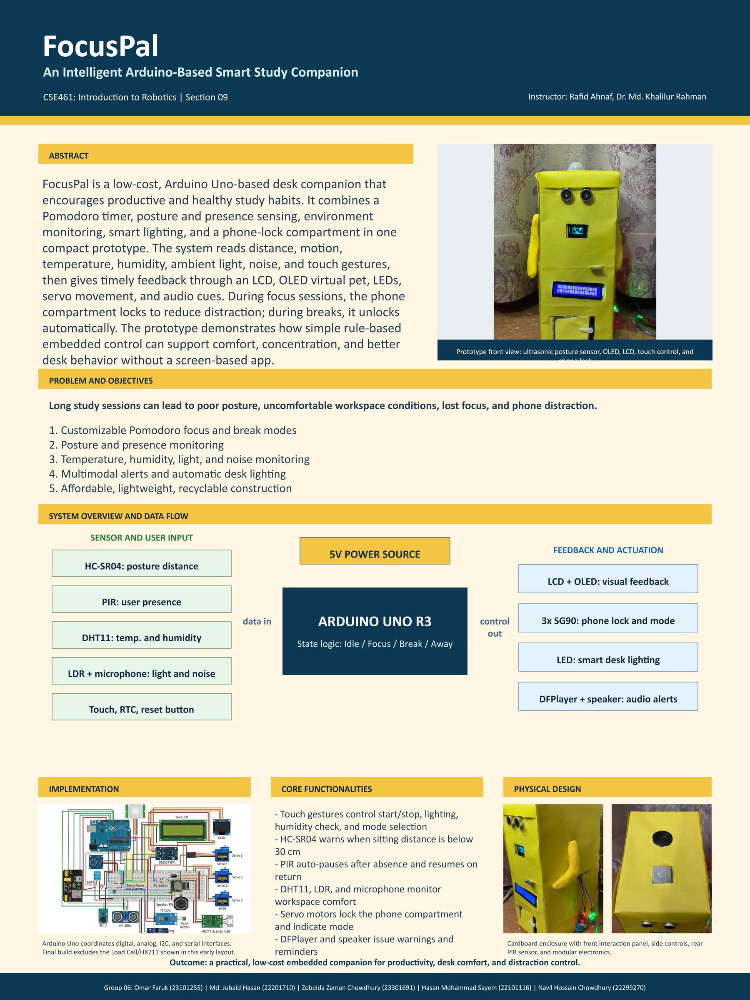</p>

## Future work

- ESP32 / Bluetooth logging of focus, posture and hydration data, with a companion app.
- Load-cell water-bottle scale for reminders based on how much you actually drink.
- More OLED expressions (focused, angry, celebrating).
- Thresholds that adapt to each user.
- A 3D-printed or laser-cut enclosure.
- A larger phone compartment.
